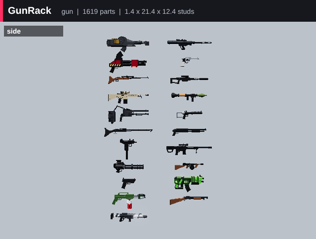
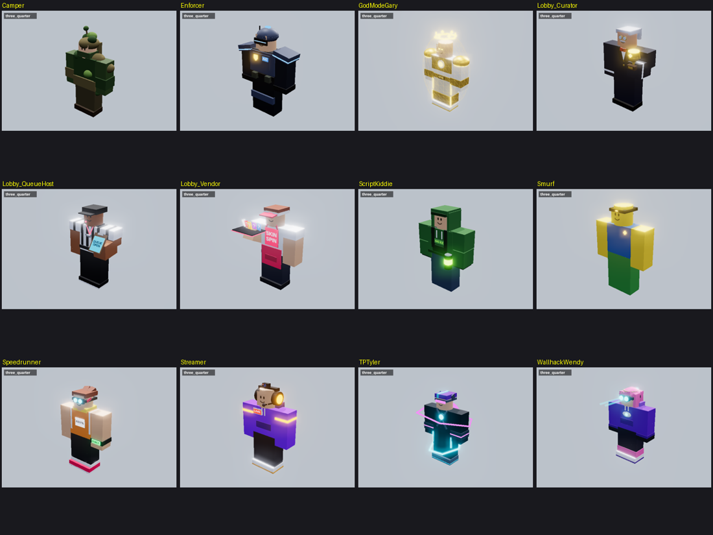
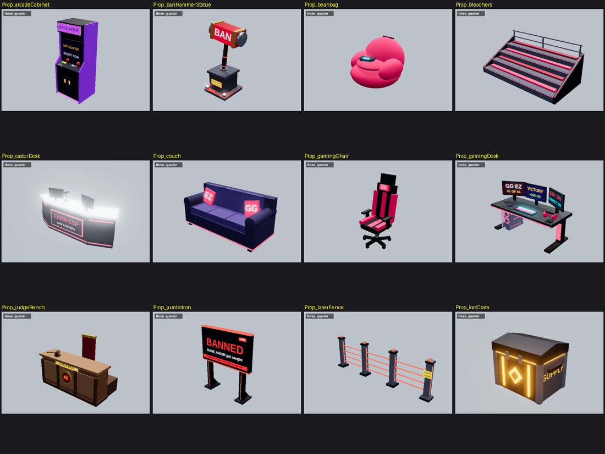
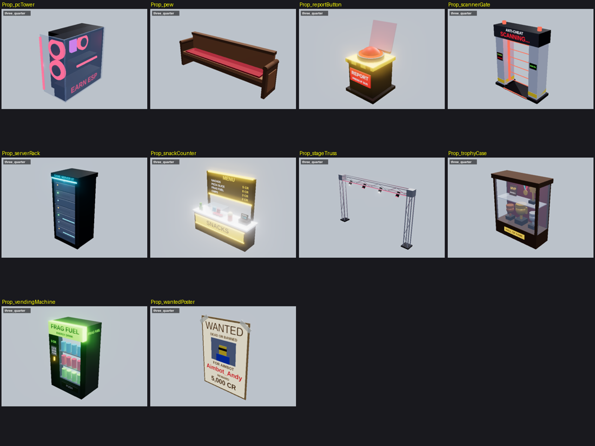
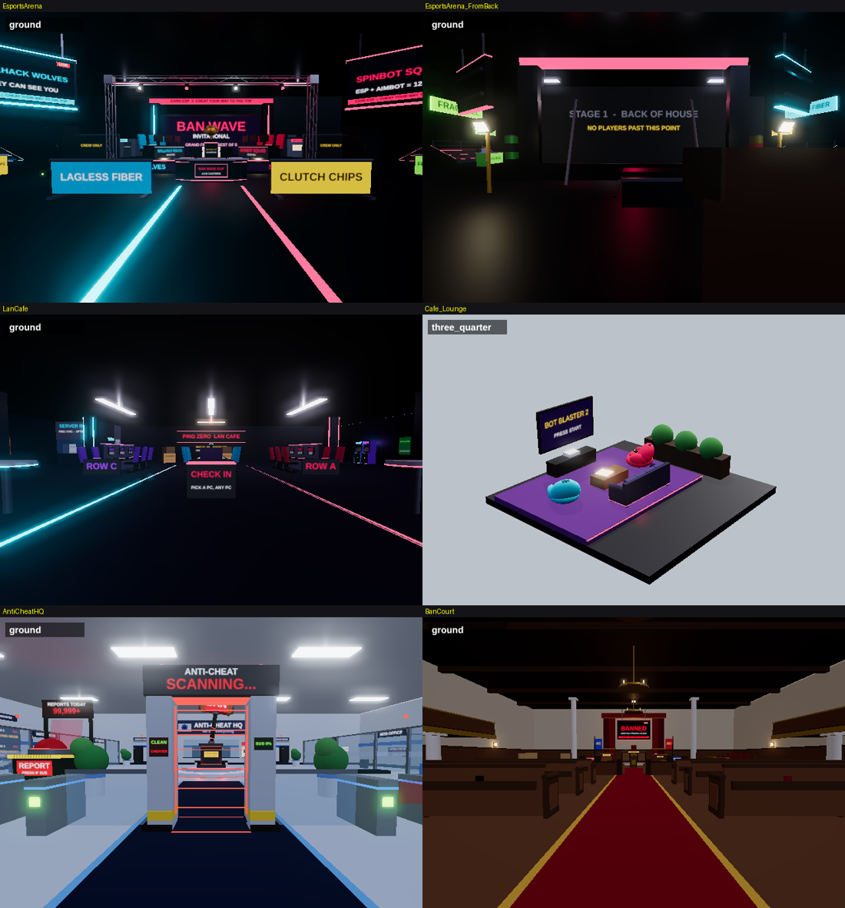

# Earn ESP models

New models for **Earn ESP (Incremental)**, saved here so they can be added to
the game later:

- **Weapons:** 13 new guns and new looks for the game's 8 guns, all built
  from the gun pictures in the vault's Inspiration note. They're written in
  the same part-list format as `GunModels.luau`, so every gun skin works on
  them.
- **Characters:** new bot types, three cheater bosses with their own trash
  talk, and friendly lobby NPCs. Their outfits are built like the bots' caps,
  visors and capes in `Bots.luau`.
- **Environment:** 22 new map props written like `Kit.luau`, plus new maps
  that use them.

Everything is Luau that builds the models from Parts. The files sit at the
same paths as in the game's Rojo project. [INSTALL.md](INSTALL.md) lists what
to copy and the few hook lines to add.

## Guns



Each gun was built from the vault's gun pictures. Its preview shows the picture on top and the model below.

**New guns** (in Guns tab order):

| Gun | Cost | Preview |
|---|---|---|
| Micro SMG | 1,200 CR | [MicroSMG](previews/guns/MicroSMG.png) |
| Tommy Gun | 2,600 CR | [TommyGun](previews/guns/TommyGun.png) |
| Trench Gun | 3,400 CR | [TrenchGun](previews/guns/TrenchGun.png) |
| Bolt Rifle | 9,000 CR | [BoltRifle](previews/guns/BoltRifle.png) |
| Marksman Rifle | 14,000 CR | [DMR](previews/guns/DMR.png) |
| Long Rifle | 22,000 CR | [LongRifle](previews/guns/LongRifle.png) |
| Heavy Repeater | 32,000 CR | [HeavyRepeater](previews/guns/HeavyRepeater.png) |
| Pulse Rifle | 40,000 CR | [PulseRifle](previews/guns/PulseRifle.png) |
| Toxic Launcher | 60,000 CR | [ToxicLauncher](previews/guns/ToxicLauncher.png) |
| Plasma Rifle | 75,000 CR | [PlasmaRifle](previews/guns/PlasmaRifle.png) |
| Auto Cannon | 110,000 CR | [AutoCannon](previews/guns/AutoCannon.png) |
| Railgun | 150,000 CR | [Railgun](previews/guns/Railgun.png) |
| Ban Cannon | 250,000 CR | [BanCannon](previews/guns/BanCannon.png) |

**New looks for the game's own guns** (same stats):

| Gun | Preview |
|---|---|
| Pistol | [Pistol](previews/guns/Pistol.png) |
| SMG | [SMG](previews/guns/SMG.png) |
| Pump Shotgun | [Shotgun](previews/guns/Shotgun.png) |
| Assault Rifle | [Rifle](previews/guns/Rifle.png) |
| Revolver | [Revolver](previews/guns/Revolver.png) |
| Sniper Rifle | [Sniper](previews/guns/Sniper.png) |
| Minigun | [Minigun](previews/guns/Minigun.png) |
| Rocket Launcher | [Rocket](previews/guns/Rocket.png) |

## Characters and props






## Maps

Esports Arena, LAN Cafe, Anti-Cheat HQ and Ban Court, from where the player spawns:



## Previews

`previews/` has a picture of every model. The pictures are made by the
preview tool in `tools/preview`, which runs the builder scripts outside
Studio:

```sh
cd tools/preview && npm install && cd ../..
export EARNESP_SRC=/path/to/EarnEsp/src   # the game's src folder, with the INSTALL.md hooks added
lune run tools/preview/check.luau          # checks guns, bots, maps and props against the game's code
tools/preview/preview.sh tools/preview/scenes/guns.luau out/guns   # renders PNGs to out/guns/png
tools/preview/gui.sh tools/preview/scenes/menus.luau out/menus     # renders the menus and HUD
```

The tool needs [Lune](https://github.com/lune-org/lune), StyLua, Node and
Playwright's Chromium.
