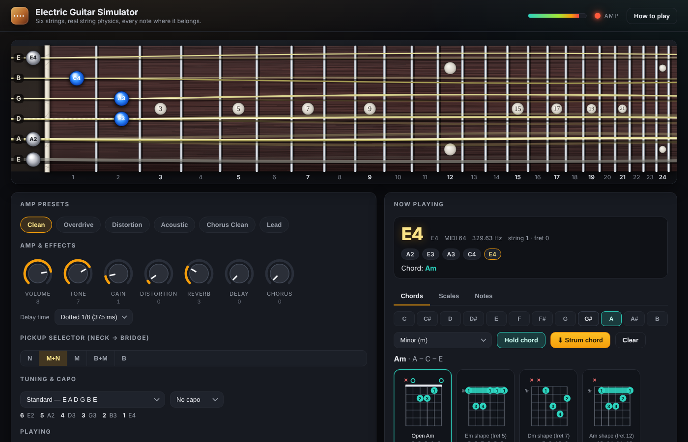
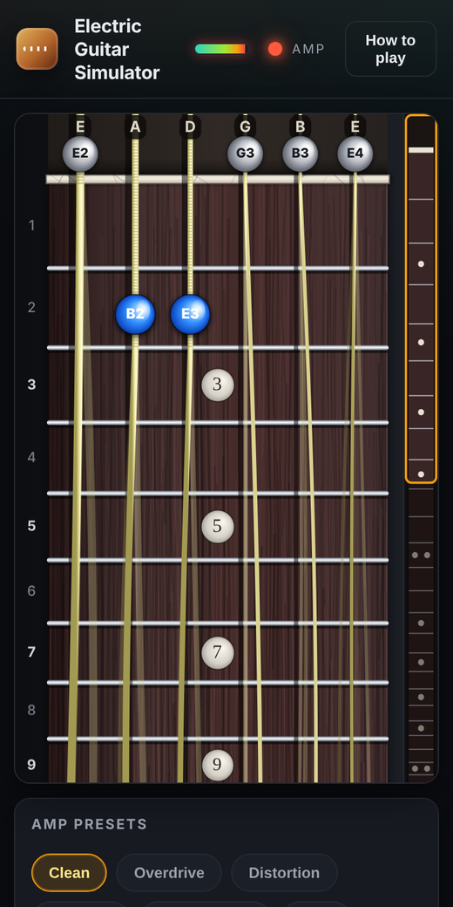

# Electric Guitar Simulator

A playable, musically accurate six-string electric guitar that runs entirely in
the browser. Tap any string at any of the 24 frets and it sounds that note —
with real string physics instead of beeps. Slide, hammer on, sweep across the
strings to strum, switch pickups, dial in the amp, change tunings, and learn
chords and scales.

No build step and no dependencies: plain ES modules, Web Audio API and Canvas 2D.





```sh
npm start            # serves the app at http://localhost:8080/ and prints the address for phones/tablets
npm run start:https  # same over https (self-signed certificate) on port 8443
npm test             # music-theory, chord-library, app-state and string-synthesis unit tests (node:test)
npm run test:e2e     # Playwright: desktop + iPad/phone interactions and offline audio pitch verification
```

Open `index.html` through any static server (modules need http://, not file://).

## Play it on your iPad or phone

1. On your computer run `npm start`. It prints the address for other devices
   (a line like `http://192.168.1.23:8080/`) together with a QR code.
2. Point the device's camera at the QR code — or type the address into Safari
   (iPad/iPhone) or Chrome (Android) — tap once to power the amp on, and play.
   The same code is in the app on your computer: **Play on phone / iPad** in
   the top bar. Turn a phone sideways for the
   biggest neck; tap **Full screen** on a tablet. The neck is zoomed on small
   screens — drag the minimap to move along all 24 frets.
3. Optional: use the browser's *Share → Add to Home Screen* to get an app icon
   that opens without browser bars.

Good to know:

- **Audio over plain http.** Browsers only allow the low-latency AudioWorklet
  on https or localhost, so a device that opens the `http://192.168…` address
  runs the very same string model on a fallback audio path (a few milliseconds
  more latency). Nothing to configure.
- **Lowest latency / offline install.** `npm run start:https` serves over
  https with a certificate generated on your machine. Open the printed
  `https://…:8443/` address on the device and accept the certificate warning
  once: the device then uses the AudioWorklet path, and an app added to the
  Home Screen keeps working with the server switched off.
- **iPhone silent switch.** The app asks iOS to treat it as media playback, so
  it sounds even when the ring/silent switch is on silent. If you hear nothing,
  check the volume buttons.
- Your computer's firewall must allow incoming connections to the port
  (8080, or 8443 for https), and both devices must be on the same network.
- If the computer has several network adapters (VPN, Docker, virtual
  machines) every address is listed; the QR code is for the most likely Wi-Fi
  or Ethernet one. `npm start -- --no-qr` hides the code.
- `?audio=script` in the address forces the fallback audio path on any device
  (useful for comparing).

## What it does

**The fretboard**
- A top-down 24-fret rosewood neck in the classic fretboard-trainer style:
  nickel frets at mathematically correct positions (`1 − 2^(−n/12)` of the
  scale length), numbered inlays at 3/5/7/9/15/17/19/21 and double dots at 12
  and 24, a bone nut, and six strings of realistic relative thickness with the
  thick low E at the bottom (tablature orientation).
- Every string is tappable at every fret; the zone before the nut plays the
  open strings. Played notes show as glossy dots with their note name.
- On desktop all 24 frets fit the screen. On phones the neck is zoomed so the
  frets stay finger-sized, with a minimap to move along it; in portrait it
  rotates to the chord-diagram orientation (nut at the top, low E on the left).
- **Full-screen play mode** (toolbar button; automatic on a phone held
  sideways): the neck fills the screen with quick strum / mute / preset
  controls, and on tablets shows the notes and chord being played.

**Playing**
- Mouse, touch and **multi-touch**: play and hold several strings at once.
- Tap a string to play it, drag along a string to slide, add or lift fingers
  for hammer-ons and pull-offs. Notes ring out when you lift (or mute, if you
  switch on fret-hand muting).
- Optional bend mode: pull a held note sideways to bend its pitch (two
  semitones per string spacing) and wiggle for vibrato; the string is drawn
  pulled along with your finger.
- Sweep across the strings to strum — on the fretboard or over the open
  strings. Sweep speed sets the picking intensity; "Pick strength" and
  "Pick position" (bridge = bright, neck = warm) shape every pluck, and touch
  pressure is used where the device reports it.
- Keyboard: `1`–`6` pick strings (1 = high E), `Space` strum down,
  `Shift+Space` strum up, `←`/`→` move along the neck, hold `M` for palm mute,
  `Esc` mutes everything.
- Capo (frets 1–7).

**Sound** (`src/audio/`)
- Each string is a digital-waveguide / extended Karplus-Strong voice. All six
  run in an `AudioWorklet` (or, where that is unavailable, the same code in a
  `ScriptProcessorNode`): deterministic pluck excitation with velocity-dependent
  brightness, pick-position comb filter, frequency-dependent loop damping,
  dispersion (string stiffness), tension-modulation pitch bend on hard plucks,
  pitch glides for slides, fret-noise bursts, pick click, release/mute damping.
- The loop length is compensated analytically for the loop filters' phase
  delay, so every note is synthesized at its exact equal-temperament frequency
  (verified to < 1 cent on every string at every fret 0–24 by the e2e suite).
- Pickup position is modelled physically (two-tap read-out at the pickup
  position along the vibrating length, so fretting changes the comb like on a
  real guitar), plus a resonant pickup EQ per selector position.
- Amp chain: gain → asymmetric wave-shaper (4× oversampled when driven hard) →
  tone → cabinet, then stereo chorus, feedback delay (selectable times),
  convolution reverb, master volume and a zero-latency soft limiter.
- Sympathetic resonance: all six strings run in one worklet and share a
  passive bridge, so strings ring in sympathy without any feedback path that
  could ever build up.
- Presets: Clean, Overdrive, Distortion, Acoustic (resonant body model instead
  of pickups), Chorus Clean, Lead. Every knob stays live.

**Music theory** (`src/theory/`)
- Nothing is hard-coded per fret: `midi(string, fret) = openMidi + fret`,
  names/octaves/frequencies derive from MIDI (A4 = 69 = 440 Hz, C4 = 60).
- Sharps or flats for every label; enharmonic equivalents available everywhere.
- Tunings: Standard, Drop D, Half-step down, Whole-step down, Open G, Open D,
  DADGAD, Drop C, Open E, Open A. Changing tuning retunes every string, label,
  chord voicing and overlay.
- Chord library: curated open and movable shapes with conventional fingerings
  for standard tuning, validated against the chord formulas; an algorithmic
  voicing generator provides correct voicings in every other tuning.
  "Hold chord" presses the shape for you so you can strum it.
- Scales: major, natural/harmonic/melodic minor, pentatonics, blues, modes,
  whole tone, chromatic — shown on the fretboard with degrees or note names.
- Highlight every position of a note; live read-out of the note played
  (name, enharmonic, MIDI, Hz, string/fret) with chord detection.

## Project layout

See [docs/ARCHITECTURE.md](docs/ARCHITECTURE.md) for modules, conventions and
the signal flow.

```
index.html, styles.css        page + dark studio theme
src/main.js                   bootstrap
src/state.js                  observable app state
src/theory/                   notes, tunings, fretboard, scales, chords, voicings
src/audio/                    worklet string model, engine, effects, presets
src/ui/                       fretboard canvas + minimap, interaction, knobs, panels
tests/*.test.js               unit tests (node --test)
tests/e2e/                    Playwright UI test + offline audio analysis
manifest.webmanifest, sw.js   installable web app + offline cache
icons/                        app icons
tools/serve.mjs, lan.mjs      tiny static server (LAN address + QR code, optional https)
```

## Testing

- `npm test` runs the theory tests (every string × every fret × every tuning,
  spec examples, enharmonics, geometry, scales, chord detection), an
  independent specification-derived suite, the chord-library validation
  (pitch content, bass note, barre/finger consistency, coverage), the string
  model in Node, and the QR encoder against a reference implementation.
- `npm run test:e2e` starts the server and drives Chromium (Playwright with its
  bundled Chromium): powers the amp on, taps and slides with the mouse, sweeps
  strums across open and fretted strings, holds two strings with simulated
  multi-touch, changes tuning, uses the chord library and presets, checks the
  phone layouts (zoomed neck, minimap panning, tapping fret 24), and renders
  every string at every fret 0–24 through the real audio engine offline,
  measuring the synthesized fundamental against equal temperament, release
  behaviour, dynamics, slides and per-preset levels.

## Browser support

Chrome, Edge, Firefox and Safari on desktop, iPadOS, iOS and Android. Sound
starts after the first tap/click, as browsers require. Headphones recommended.

The automated tests run in Chromium, including emulated iPad and phone screens
with touch input and the fallback audio path. Safari on real iOS/iPadOS
hardware and Firefox are supported by design (standard Web Audio, pointer
events, no browser-specific code paths beyond the documented iOS audio unlock)
but are not part of the automated suite.
